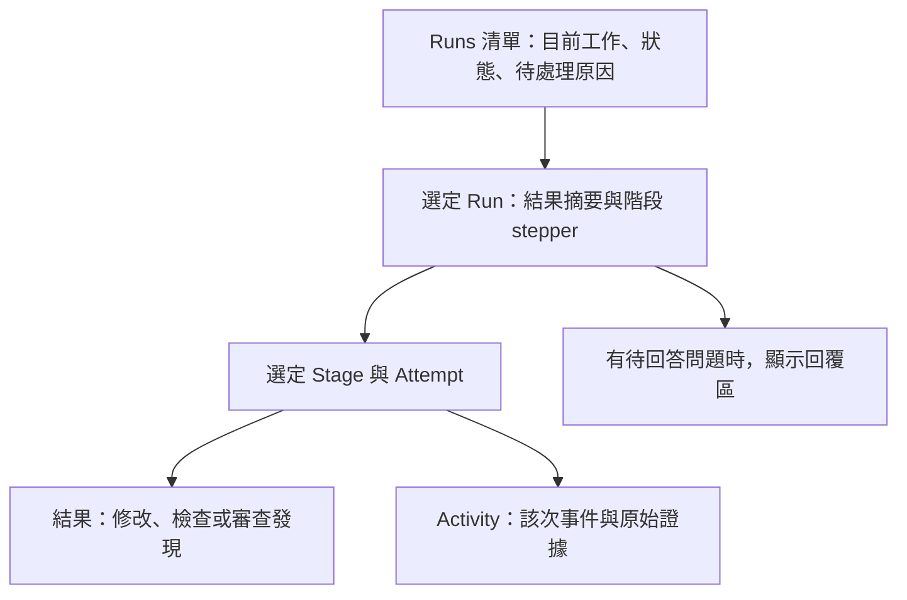

# oat-agents 研究：可套用到 Codex Cage 的方法

研究日期：2026-10-15。遠端依據為 oat-agents main 的 [c830f3e](https://github.com/Noopher-AI/oat-agents/commit/c830f3e59726086fcb3d86dd6e0415687bd40d9b)，該提交日期為 2026-10-11；本機依據為 Codex Cage 6cfee73。

本次閱讀 README、ADR、角色協定、協調／訊息／執行證據／TUI 原始碼，並對照本機 Runner 與 Control Room。未安裝或實際執行 oat-agents；以下區分已讀到的行為與建議，操作穩定性和效能仍待實測。這份文件是研究與提案，尚未變更產品行為。

後續討論聚焦於花費、嘗試紀錄與人工介入。多代理協作僅作背景比較，採用這些概念不以加入 meta-agent 或並行 worker 為前提。

## 判斷

兩者都在解決「把工作交給 coding agent 後，如何掌握過程、判斷結果」；執行模型有明顯差異。

oat-agents 用一個 meta-agent 協調一層 member agents，人可以觀察或接手原生 session。Codex Cage 用程式控制固定的實作、驗證、審查與發布流程。對你最有價值的借鏡，是讓每次工作嘗試、證據和需要人介入的原因成為 GUI 可操作的資料。現有固定流程與發布 gates 可以繼續當骨架。[oat-agents 架構分工 ADR](https://github.com/Noopher-AI/oat-agents/blob/c830f3e59726086fcb3d86dd6e0415687bd40d9b/.dev_docs/adr/0004-the-cli-owns-how-the-workflow-runs.md)、[本機工作流程](../src/run-workflow.ts)

## 兩者對照

| 面向       | oat-agents 的現況                                                              | Codex Cage 的現況與含義                                                            |
| ---------- | ------------------------------------------------------------------------------ | ---------------------------------------------------------------------------------- |
| 工作入口   | 自然語言 goal                                                                  | CLI 接 issue；目前 Web intake 限 GitHub Issue                                      |
| 協調者     | meta-agent 依團隊指令拆分與調度                                                | Runner 以程式執行固定流程，已有 bounded retry                                      |
| 工作單位   | Run 下有多個 Dispatch；重試建立新 Dispatch                                     | Run 下已有 stage attempts，但沒有獨立子任務／agent dispatch 模型                   |
| Agent 互動 | 持續存在的原生 Claude Code／Codex session，透過 tmux 操作                      | 非互動式 codex exec；GUI 目前提供觀察與 artifacts                                  |
| 工作區     | worker 通常另開 worktree／branch；example reviewer 使用 worker 的既有 worktree | 預設每 Run 在 Docker volume clone；另有供外部隔離 runner 使用的 direct mode        |
| 審查與完成 | example plugin 規定 reviewer、修正和合併；Run 結束輸出 receipt／留下 branches  | 程式化 verify、secret guard、獨立 structured review；通過後由 orchestrator 發 PR   |
| 可觀察性   | roster、diff、timeline、log；活動偵測能力依 backend 而異                       | 已有版本化 events.ndjson、replay、SSE snapshot、五階段 detail 與 artifact endpoint |
| 團隊設定   | Markdown／TOML plugin，角色可選 backend、model、skills、concurrency            | 設定、prompt、review policy 已分工；目前 implement／review 共用 agent.model        |

遠端依據：[README](https://github.com/Noopher-AI/oat-agents/blob/c830f3e59726086fcb3d86dd6e0415687bd40d9b/README.md)、[plugin 格式](https://github.com/Noopher-AI/oat-agents/blob/c830f3e59726086fcb3d86dd6e0415687bd40d9b/docs/plugins.md)、[實際 launch](https://github.com/Noopher-AI/oat-agents/blob/c830f3e59726086fcb3d86dd6e0415687bd40d9b/src/launch/mod.rs)。本機依據：[workflow](../src/run-workflow.ts)、[config](../src/config.ts)、[events](../src/run/events.ts)、[Control Room](../src/control-room.ts)。

## 它實際怎麼協作

1. meta-agent 接 goal，步驟不明確時先找 planner；具體任務可跳過 planner。
2. 將互不依賴的工作交給 worker 並行執行。example worker 的 concurrency 上限為 3；這是可設定的團隊預設。
3. member 透過 Run inbox 回報完成或提出問題；meta-agent 是 inbox 的唯一消費者。未 ACK 的 delivery 會重送。
4. reviewer 檢查 worker 的 worktree；example 團隊要求 PASS 後才由 meta-agent 合併。FAIL 後另派新的 worker 修正，保留之前的 Dispatch。
5. 需要人的判斷時，meta-agent 記錄問題，人接手 session 回答。最後結束 Run 並輸出 receipt。

這是 example 團隊的策略；分工與重試策略主要放在 agent 指令。核心掌管啟動、資源、訊息和紀錄。[團隊指令](https://github.com/Noopher-AI/oat-agents/blob/c830f3e59726086fcb3d86dd6e0415687bd40d9b/plugins/example/core/oat-meta-instruction.md)、[worker 設定](https://github.com/Noopher-AI/oat-agents/blob/c830f3e59726086fcb3d86dd6e0415687bd40d9b/plugins/example/roles/worker/role.toml)、[meta 協定](https://github.com/Noopher-AI/oat-agents/blob/c830f3e59726086fcb3d86dd6e0415687bd40d9b/assets/core/oat-meta-baseline.md)、[inbox 實作](https://github.com/Noopher-AI/oat-agents/blob/c830f3e59726086fcb3d86dd6e0415687bd40d9b/src/store.rs#L367-L440)

## 最值得借用的七個方法

### 1. 每次嘗試保留獨立證據

它把每次 Dispatch 當成獨立紀錄，失敗修正另開一個，讓人看見工作如何演變。[Dispatch 與顯示模型](https://github.com/Noopher-AI/oat-agents/blob/c830f3e59726086fcb3d86dd6e0415687bd40d9b/src/tui/model.rs#L295-L345)

你已經有 stageAttempt、每輪 implementation prompt 和 review JSON，但 phase log 固定使用 implement.log、verify.log、review.log；後一輪會覆寫前一輪。GUI 目前顯示最新 attempt 狀態，事件則混合該 stage 的所有 attempts。這會讓舊事件指向已變更的證據。[journal](../src/run/journal.ts)、[artifact 寫入](../src/state.ts)、[Run details](../web/control-room/components/run-details.tsx)

建議先做：每個 attempt 使用不可覆寫的檔名，例如 implement-1.log、verify-2.log，並保存當輪 diff。GUI 增加 attempt selector，依 stage＋attempt 顯示事件與 artifacts。既有固定檔名若要保留相容性，僅當作 latest 別名；歷史事件必須指向固定版本。舊 Run 已覆寫的內容只能標示不可取得。

### 2. 分開「執行完成」與「結果通過」

它的角色協定明確區分：reviewer 完成審查、給出 FAIL，Dispatch 仍可成功完成；執行失敗則是另一回事。缺工具或服務而無法跑檢查，應回報未驗證。[角色協定](https://github.com/Noopher-AI/oat-agents/blob/c830f3e59726086fcb3d86dd6e0415687bd40d9b/assets/core/role-protocol.md)

你已有 ReviewReport 的 pass／blocking 與 command outcome；建議把它們直接呈現為 GUI 結果。例如「審查完成 · 發現 2 個阻擋問題」，另以「審查程序失敗」表示 agent 沒產出有效報告。環境缺失應顯示「未驗證」與原因，發布 gate 仍要阻擋。

目前 PublicRunEvent 僅提供摘要字串，沒有保留 review verdict、reportRef、exitCode 等原始結構；需要明確 DTO 或經驗證的 artifact 讀取來支援結果畫面。避免從 summary 反向解析業務狀態。[ReviewReport](../src/review.ts)、[事件 schema](../src/run/events.ts)、[public projection](../src/control-room.ts)

### 3. 把驗證結果綁定到實際程式版本

這是它比單純多開 agent 更值得學的一點。execution ledger 記錄 command、exit status、image 和程式內容 fingerprint，並比較執行前後的程式內容。內容未知、過程中變動或 image 改變，都會阻止把該紀錄當作可沿用的驗證證據；通過機械檢查仍不代表語意上適合重用。[執行環境](https://github.com/Noopher-AI/oat-agents/blob/c830f3e59726086fcb3d86dd6e0415687bd40d9b/docs/exec-environments.md)、[fingerprint](https://github.com/Noopher-AI/oat-agents/blob/c830f3e59726086fcb3d86dd6e0415687bd40d9b/src/env/fingerprint.rs)、[證據分類](https://github.com/Noopher-AI/oat-agents/blob/c830f3e59726086fcb3d86dd6e0415687bd40d9b/src/env/commands.rs#L427-L487)

建議 Verify 的每筆結果帶 command、時間、exit code、attempt、image digest 與變更內容識別。GUI 可以回答「這個通過結果驗證的是哪一版修改」。目前先保存來源，繼續照常跑檢查；等有並行任務或明確成本瓶頸，再評估結果重用。只有 commit SHA 不足以識別尚未提交的修改。

### 4. 把「需要你回答」建模成可追蹤狀態

它用 needs_human／human_answer 事件讓畫面知道哪個 Run 正在等人；member 的提問則經 inbox 到 meta-agent，避免所有 agent 同時找使用者。[問題事件](https://github.com/Noopher-AI/oat-agents/blob/c830f3e59726086fcb3d86dd6e0415687bd40d9b/src/commands/log.rs)、[問題投影](https://github.com/Noopher-AI/oat-agents/blob/c830f3e59726086fcb3d86dd6e0415687bd40d9b/src/tui/model.rs#L348-L363)

你的 GUI 適合在 Run 頂部顯示一個待回答區：具體問題、影響、選項或文字回答、送出狀態。回答要有 questionId、對應 attempt 和事件紀錄；重複送出不能重複啟動工作，Run 結束後的回答應被拒絕。

這需要 Runner 的等待／續行機制。現有 codex exec 和 cancel endpoint 不能直接支援即時問答；「下輪套用補充指令」、「暫停後繼續」、「接手原 session」也應分別定義。這項應排在證據呈現之後，不宜先做一個實際無法送達 agent 的聊天框。

### 5. 從系統事件觀察活動，少要求 agent 寫進度

它盡量從 session 和執行紀錄推導狀態；但並非完全沒有人工式回報，meta-agent 仍須記錄決策、維護 checklist。更重要的是，這個版本的 Claude transcript 可提供活動訊號，Codex liveness 在該實作中會回傳 null；Codex 的 usage／model／context 則由另一個模組讀取。[liveness](https://github.com/Noopher-AI/oat-agents/blob/c830f3e59726086fcb3d86dd6e0415687bd40d9b/src/liveness.rs)、[Codex session reader](https://github.com/Noopher-AI/oat-agents/blob/c830f3e59726086fcb3d86dd6e0415687bd40d9b/src/codex_session.rs)

你應保留 journal 為狀態來源。下一步可由執行 adapter 提供程序存活、最後輸出、已執行多久、目前 command 等觀測；若要採 CLI 的結構化輸出，先確認專案釘選版本的介面，再轉成內部事件。

GUI 分開顯示「瀏覽器連線正常」、「Runner 還活著」、「目前有新活動」、「正在等回答」。單純一段時間沒有輸出，只能表示安靜，不能直接判定卡死或自動重試。

### 6. 協定、團隊策略與呈現各有邊界

它將生命週期／訊息規則放核心，角色做法放 plugin，TUI 再讀 Store 與 log 建立 projection；執行中的 Run 使用已解析的 plugin snapshot。[核心分工 ADR](https://github.com/Noopher-AI/oat-agents/blob/c830f3e59726086fcb3d86dd6e0415687bd40d9b/.dev_docs/adr/0004-the-cli-owns-how-the-workflow-runs.md)、[plugin snapshot](https://github.com/Noopher-AI/oat-agents/blob/c830f3e59726086fcb3d86dd6e0415687bd40d9b/src/plugins/snapshot.rs)

你已經有 run-workflow、journal、gates、prompt、review-policy 和 Control Room projection，可沿用這個分工。短期只需補 run 使用的 review policy hash、CLI 版本與 runtime 身分；未來有需求時再拆 implement／review 的 model 與 effort 設定。延續原先 native AGENTS.md 的決定，避免重新注入整份指令。完整 plugin 系統可以等多組團隊設定確實需要共用時再做。

### 7. 多代理協作要增加工作單位與整合責任

它的單層團隊、角色 concurrency 和獨立 worktree 適合借鑑；但 member 完成後還需要明確的結果驗收、合併和資源回收。inbox ACK 解決重送，不等於所有後續副作用自動具備 exactly-once 保證。[meta 協定](https://github.com/Noopher-AI/oat-agents/blob/c830f3e59726086fcb3d86dd6e0415687bd40d9b/assets/core/oat-meta-baseline.md)、[inbox](https://github.com/Noopher-AI/oat-agents/blob/c830f3e59726086fcb3d86dd6e0415687bd40d9b/src/store.rs)

如果你之後希望同一個 issue 同時有前端、後端與測試 agent，建議仍保留外層固定 stages，在 Implement 裡加入 Task 與 Dispatch／Attempt，讓每個工作有輸入、輸出、依賴和受控 concurrency。整合者產出唯一變更版本後，再走既有 Verify、Review、Publish。不要把現有五個 stages 顯示成五個同時存在的 agent。

首次實驗可從互不寫入的分析工作開始，例如測試影響分析與程式分析。多個 worker 同時寫 code 前，要先解決 workspace 隔離、衝突處理、整合後重驗證，以及誰有 commit／publish 權限；繼續由 orchestrator 擁有最終發布責任。

## GUI 建議：延伸現有 Runs workspace

沿用現在的 Runs 清單、深連結 detail、五階段 stepper 和單一 focused panel。既有設計方向以本機程式與 recap 為準；web/design/runs-page.png 是舊參考，含已移除的側欄和卡片，不作為恢復舊版面的依據。

下圖是建議的資訊結構，不代表已實作的新畫面：

| 區域           | 使用者要得到的答案         | 建議內容                                                         |
| -------------- | -------------------------- | ---------------------------------------------------------------- |
| Runs 清單      | 哪件事需要注意？           | issue 標題、階段、狀態、最後活動；待回覆與失敗原因直接可見       |
| Run 摘要       | 現在做到哪，接下來會怎樣？ | 結果摘要、當前工作、發布 gate 狀態、下一步；raw IDs 保留次要位置 |
| Stage＋Attempt | 哪一輪，為什麼重跑？       | 最新一輪為預設，可切歷史；保留當輪失敗原因、對應修正與證據       |
| Implement      | 改了哪些地方？             | 變更摘要、檔案清單、當輪 diff                                    |
| Verify         | 跑了什麼，驗證哪版？       | 命令、結果、時間、程式版本、環境；原始 log 可展開                |
| Review         | 有哪些阻擋問題？           | 結論、finding、檔案／行號、修正方向；連到對應 attempt            |
| Publish        | 產出什麼？                 | branch、commit、PR 連結與結果                                    |
| 需要回答       | 我現在應該決定什麼？       | 單一問題、影響和回答控制；有真實待處理問題才出現                 |

先顯示有意義的結果，再展開 log／JSON；所有內容依選定 stage＋attempt 篩選。桌面可讓檔案清單與 diff 並排，手機改成逐層進入。保留文字狀態、鍵盤操作、可見 focus；查看歷史時，新事件不應強制切回最新或捲走閱讀位置。

Terminal 可以是未來的進階接手入口。要達到 oat-agents 的「同一 session 接手」，後端還需要持續 session、輸入傳輸、控制權交接與中斷後的續行規則。Web terminal 的顯示元件本身無法補上這些能力。[它的實際輸入轉送](https://github.com/Noopher-AI/oat-agents/blob/c830f3e59726086fcb3d86dd6e0415687bd40d9b/src/tui/control.rs)

## 建議實作順序

以下為建議，尚未建立 issue 或承諾改動範圍。

| 順序 | 可獨立交付的切片                              | 主要位置                                                    | 驗收重點                                                            |
| ---- | --------------------------------------------- | ----------------------------------------------------------- | ------------------------------------------------------------------- |
| 1    | 每次 attempt 保存 log／diff，GUI 可切換與篩選 | journal、state、public artifact metadata、run-details       | 跑過至少兩輪後，舊事件仍打開舊內容；舊 Run 缺資料有明確狀態         |
| 2    | Verify／Review／Changes 顯示結構化結果        | public DTO、已驗證的 artifact reader、run-details           | blocking finding 能直接閱讀；執行錯誤與負面結論分開；不解析摘要字串 |
| 3    | 驗證證據版本與活動觀測                        | sandbox-execution、journal、events、Control Room projection | 看得出測試對應哪版／哪個環境；連線中斷與程序安靜分開顯示            |
| 4    | 有限的人工補充／等待回覆                      | Runner 狀態機、事件協定、回覆 endpoint、Run detail          | 回答確實送達指定工作；重送、晚到、取消與重啟有明確行為              |
| 5    | 同一 Run 的有限多代理協作                     | Implement 內部 Task／Dispatch、workspace、整合者            | concurrency 受控、每個工作有證據、整合後重新跑完整發布 gates        |

前三項能直接強化目前機制，並為後面的互動與協作提供基礎。你之前遇到的 GitHub preflight 失敗，也適合用相同結果呈現原則處理：第一個 Runner 事件出現前就失敗，GUI 仍應顯示可修復的原因，而非只有 internal_error。現有 auth diagnostics 可作為入口。

## 不宜直接移植的部分

- **一般主機上的執行權限。** 該版本從 host 啟動 agent 並關閉其 sandbox／approval prompts；pod 主要承接指定的 build／test 命令，worktree 不提供程序權限隔離。你應維持本機 Docker 邊界；既有 direct mode 繼續限於外部已隔離的 runner。[launch](https://github.com/Noopher-AI/oat-agents/blob/c830f3e59726086fcb3d86dd6e0415687bd40d9b/src/launch/mod.rs#L40-L59)、[exec environments](https://github.com/Noopher-AI/oat-agents/blob/c830f3e59726086fcb3d86dd6e0415687bd40d9b/docs/exec-environments.md)
- **把團隊指令當發布保證。** example plugin 有 review／retry 規範，但讀到的 meta finish 實作會關閉 Run、處理清理與 receipt，沒有你的程式化 verify／review／secret publish gates。你應維持現有 gates。[finish 實作](https://github.com/Noopher-AI/oat-agents/blob/c830f3e59726086fcb3d86dd6e0415687bd40d9b/src/commands/meta.rs#L290-L357)
- **為了 GUI 增加 Kubernetes、tmux 或通用 workflow editor。** 這些是它的實作選擇；目前 Control Room 的 HTTP／SSE 與 Docker 已能承接建議中的主要功能。
- **現在就更換 storage 或導入整套 plugin 生態。** 你已有 SQLite、artifact files 和版本化事件；先補資料完整性與投影，能以較小變更得到可見成果。

## 後續驗證

優先用含兩次以上 Verify／Review attempts 的真實 Run 檢查資料是否完整，再驗證重播、歷史證據、斷線／重連與 populated GUI。人工等待和多代理屬後續架構提案，尚未驗證 session 續行、持久化等待、任務整合或成本效益。

## 後續聚焦：花費、嘗試與人工介入

三者可以加入現有固定流程，但所需的改動層次不同：

| 概念       | 適合放的位置                                   | 現況與建議                                                                                                                       |
| ---------- | ---------------------------------------------- | -------------------------------------------------------------------------------------------------------------------------------- |
| 用量／花費 | 每次 Codex invocation，再彙總到 iteration／Run | 目前沒有用量事件；先記錄 implement 與 review 的用量、耗時及資料完整性，包含失敗與重試。金額與 token 用量分開建模，缺資料顯示未知 |
| 嘗試       | 現有 iteration／stageAttempt 與其證據          | 已有執行次數，先解決 log 覆寫，再串起重試原因、當輪修改、驗證結果及用量；一次實作迭代不保證走到 Review，不能直接混用各種計數     |
| 人工介入   | Runner 的執行控制狀態與階段間 checkpoint       | 需要新增等待、保留工作區、持久化回覆與續行行為；目前只有執行到終態與取消，沒有等待回答的協定                                     |

目前的限制可從程式直接看到：子程序使用 stdin ignore；重試 feedback 是執行程序內的陣列；Run 結束的 finally 一律清理 runtime。事件 replay 重建的是觀察畫面，並未實作恢復執行狀態。[execution adapter](../src/sandbox-execution.ts)、[workflow](../src/run-workflow.ts)、[事件 replay](../src/run/events.ts)

較合適的第一種人工介入，是在下一輪 agent invocation 前停靠。例如同一原因連續失敗，先保存修改與失敗證據，GUI 顯示原因，讓使用者補充要求後再進入下一輪。等待狀態與 Prepare／Implement／Verify 等工作階段應分開建模；回覆後仍需通過原有發布 gates。是否需要發布前人工確認，應另作可選產品策略，不預設增加到所有 Runs。

實作時必須定義等待期間的工作區保存與過期清理、active timeout 是否暫停、服務重啟後如何續行，以及重複／晚到回覆的處理。把 cancel 改名成 pause 無法提供這些保證。

另一種介入是 agent 主動回報需要資訊。可設計結構化的 needs_input 結果，讓本次 invocation 結束後由 Runner 保存問題並等待；下一次 invocation 帶入回答與既有工作。這能提供 GUI 問答，不必先建即時 terminal 接手。執行中任意插話或接手同一 session，則是更深一層的 runtime 能力，暫不作第一版前提。

官方目前記載 codex exec 的 JSONL 輸出含 turn.completed usage，可供 token 觀測；專案釘選的 CLI 版本仍需實測確認欄位與行為。即使命令失敗或中斷，也不能把沒有收到 usage 當成零消耗。[官方非互動模式文件](https://learn.chatgpt.com/docs/non-interactive-mode#make-output-machine-readable)

ChatGPT 登入與 API key 的計費方式不同；API 費率換算值不能直接標成訂閱帳號的實際扣款。GUI 應分開呈現已觀測用量、已知計費方式下的估算，以及資料不足狀態。若先採「每輪結束後檢查預算、決定是否啟動下一輪」，它是檢查點控制，無法保證執行中的單次呼叫不超過預算。[官方計費說明](https://learn.chatgpt.com/docs/pricing)

建議下一個設計目標是把單次嘗試的證據與用量串好，再選一個明確的人工停靠觸發條件。觸發門檻、預算種類與等待期限尚未定案；此補充不代表已授權實作。
